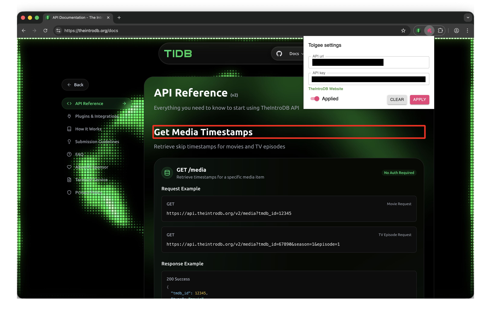
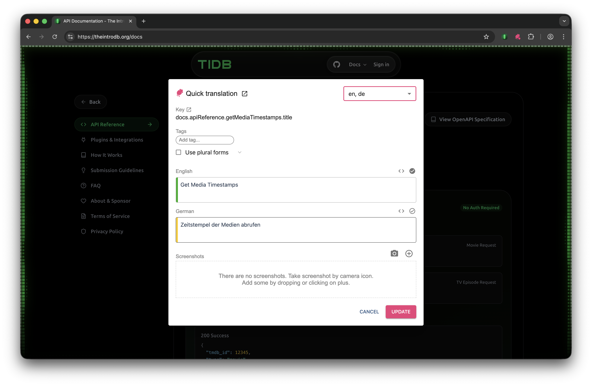

### TheIntroDB – Translations

---

1. Integration Translations
2. Website Translations

## Integration Translations

TheIntroDB integrations such as plugins, addons, and browser extensions are maintained in their respective repositories

https://github.com/orgs/TheIntroDB/repositories

To edit or add translation files or strings for an integration, please open a pull request in the relevant repository.

<!-- integration-translation-report:start -->

### Integration Status

This table is generated automatically by the scheduled workflow and scans each integration repository for translation directories and locale folders. `Not detected` means the scan did not find a recognized translation structure in the repository tree.

| Repository | Translation Path(s) | Languages |
| --- | --- | --- |
| [universal-extension](https://github.com/TheIntroDB/universal-extension) | [src/i18n/locales](https://github.com/TheIntroDB/universal-extension/tree/main/src/i18n/locales) | cs_cz, de, en, es, nl, pl_pl, zh_cn |
| [jellyfin-plugin](https://github.com/TheIntroDB/jellyfin-plugin) | Not detected | - |
| [stremio-enhanced-plugin](https://github.com/TheIntroDB/stremio-enhanced-plugin) | Not detected | - |
| [kodi-addon](https://github.com/TheIntroDB/kodi-addon) | [plugin.video.tidb/resources/language](https://github.com/TheIntroDB/kodi-addon/tree/main/plugin.video.tidb/resources/language) | ar_sa, en_gb, es_es, pl_pl, zh_cn |
| [emby-plugin](https://github.com/TheIntroDB/emby-plugin) | Not detected | - |

<!-- integration-translation-report:end -->

## Website Translations

We use Tolgee to manage various translations for the website.

If you'd like to help translate the website, visit https://translate.theintrodb.org/public-projects or email [translate@theintrodb.org](mailto:translate@theintrodb.org) for additional details.

To help translate with Tolgee, install the Tolgee Tools extension

[Chrome](https://chromewebstore.google.com/detail/tolgee-tools/hacnbapajkkfohnonhbmegojnddagfnj)
[Firefox](https://addons.mozilla.org/en-US/firefox/addon/tolgee-tools/)

Then:

1. Go to the `Integrate` tab on the translation site.
2. Select `React`.
3. Create an API key.
4. Apply the API key in the extension.
5. Head to [TheIntroDB](https://theintrodb.org) to edit the site.

After that, hold `Alt` on Windows/Linux or `Option` on macOS and click any string on the page to open the translation menu.

---

  
    
  <b>TheIntroDB</b> · community-submitted intro, recap, credits and preview timestamps for your media server 
  <a href="https://theintrodb.org">theintrodb.org</a> · <a href="https://github.com/TheIntroDB">GitHub</a> · <a href="https://discord.com/channels/1457550295742812307/1457550298255200380">Discord</a>

